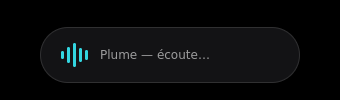

# Plume pour Linux — **version beta, a tester**

> Ceci n'est **pas** la version officielle de Plume. C'est un portage de test :
> le but est de savoir si la dictee de Plume fonctionne bien sous Linux, et sur
> quelles distributions. Signale ce qui casse, ca ameliore la version finale.

[Plume](https://github.com/ppocass/plume) est une dictee locale : on appuie sur
une touche, on parle, le texte apparait la ou est le curseur. Tout se passe sur
la machine, rien ne part dans le cloud.

Sur macOS, c'est une app native en SwiftUI. Ici, c'est la **meme logique**, en
ligne de commande, avec ce que Linux fournit a la place des briques Apple.

---

## Ce qui marche

| | macOS | Linux (cette version) |
|---|---|---|
| Micro | `AVAudioEngine` | `parecord` (PipeWire / PulseAudio) |
| Moteur | `whisper.cpp` (Metal) | `whisper.cpp` (CPU, ou CUDA/Vulkan si dispo) |
| Transcription | ✅ | ✅ **meme code** |
| Barriere anti-silence | ✅ | ✅ **meme code** |
| Decoupage aux pauses (8 s) | ✅ | ✅ **meme code** |
| Lissage par un LLM | ✅ | ✅ **meme code** |
| Vocabulaire | ✅ | ✅ **meme code** |
| 1337 | ✅ | ✅ **meme code** |
| Collage au curseur | `AXUIElement` + ⌘V | `xdotool type` |
| Raccourci global | `CGEventTap` | raccourci du bureau |
| Pastille | `NSPanel` + SwiftUI | GTK4 (prototype joint) |

**En clair** : tout le cerveau de Plume est le meme. Ce qui change, c'est la
couche qui touche au bureau Linux.

## Ce qui ne marche pas encore

- **Pas de pastille** dans cette version : la dictee est en ligne de commande.
  Un prototype GTK4 fonctionnel est dans `pastille/` (voir plus bas).
- **Wayland** : `xdotool` ne peut pas taper dans les autres fenetres. Il faut
  `ydotool` (demon root) ou `wtype`. **X11 est le cas teste et supporte.**
- **Pas de fenetre de reglages** : la configuration est un fichier JSON.
- **Pas d'installation automatique des mises a jour.**

---

## Installation

```bash
git clone https://github.com/ppocass/plume-linux.git
cd plume-linux
./install.sh
```

Le script installe `parecord`/`xdotool` si besoin, compile `whisper-server`
(le meme que sur macOS), telecharge le modele Whisper (548 Mo, verifie par
SHA-256) et installe le binaire dans `~/bin/plume`.

Il faut **Swift 6.4+** pour compiler. Sur Debian/Ubuntu :

```bash
# Debian 13 / Ubuntu 24.04+
sudo apt install swiftlang      # ou la toolchain officielle swift.org
```

> **Piege connu** : le paquet `swiftlang` de Debian 13 est en Swift **6.0.3**,
> qui refuse les virgules finales dans les appels de fonction (ajoutees en 6.1).
> Si la compilation echoue sur `unexpected ',' separator`, installe la
> toolchain officielle : <https://www.swift.org/install/linux/>

## Utilisation

```bash
plume listen      # dicter : Entree pour commencer et arreter
plume trigger     # une dictee de 15 s (pour un raccourci du bureau)
plume text x.wav  # transcrire un fichier WAV
plume check       # verifier micro, moteur, outils
```

### Le raccourci

`plume trigger` est fait pour etre lance par un raccourci clavier du bureau.

**XFCE** (le cas d'Alexandre) :
`Parametres > Clavier > Raccourcis d'application > Ajouter`
→ commande : `plume trigger` → touche : celle que tu veux (`Super+D`, par exemple).

**GNOME** : `Parametres > Clavier > Raccourcis personnalises`.

Duree d'enregistrement reglable :
```bash
PLUME_SECONDS=30 plume trigger
```

## Si le port 8090 est pris

Sur certaines machines, 8090 est deja utilise (par exemple par crowdsec). Plume
lit `PLUME_PORT` :

```bash
PLUME_PORT=8091 plume listen
```

Et le service systemd doit alors utiliser le meme port (voir
`~/.config/systemd/user/plume-engine.service`).

## La pastille GTK4

`pastille/` contient un prototype complet et mesure de l'indicateur visuel —
la capsule sombre qui apparait en bas de l'ecran sur macOS.

```bash
cd pastille
gcc pill.c -o pill $(pkg-config --cflags --libs gtk4) \
                    $(pkg-config --cflags --libs gtk4-layer-shell-0) -lX11
./pill
```



Trois choses apprises en l'ecrivant, qui valent pour quiconque veut faire une
fenetre flottante sous Linux :

1. **GTK4 a supprime `GTK_WINDOW_POPUP`.** `gtk_window_new()` ne prend plus
   d'argument, tout est TOPLEVEL.
2. **`gtk4-layer-shell` est Wayland seulement.** Sous X11 il refuse de
   s'initialiser (« not on Wayland ») et toutes ses fonctions ne font rien.
   Sous X11, on passe par `XMoveWindow` en Xlib.
3. **`override_redirect` doit etre pose avant le map.** Pose apres, le
   compositeur a deja compose la fenetre et elle disparait.

---

## Comment c'est fait

Le portage ne reecrit rien : il donne a Linux l'equivalent de chaque brique
Apple. Les six differences reelles, toutes mesurees pendant le portage :

| Sur macOS | Sous Linux | Pourquoi |
|---|---|---|
| `CryptoKit` | `swift-crypto` | Meme API, paquet Apple, MIT |
| `Foundation` | `FoundationNetworking` | `URLSession`/`URLRequest` y vivent |
| `mach`, `sysctl` | `/proc` (`meminfo`, `cpuinfo`, `stat`, `exe`) | Pas de noyau mach |
| `Security` (trousseau) | fichier en `0600` | Pas de trousseau standard |
| `Combine` | declarations vides | Le code n'utilise que les marqueurs |
| `FileManager.trashItem` | specification XDG | `~/.local/share/Trash` |

Tout est dans `portage/linux_port.py`, avec un commentaire par retouche. Le
depot Plume d'origine n'est jamais modifie.

**Ce qui compile tel quel, sans une ligne changee** : `SpeechGate`,
`SpeechEngine`, `Polisher`, `Vocabulary`, `Leet`, `History`, `ModelStore`,
`ModelCatalog`, `CloudTranscriber`, `VoiceCommands`, `Log`. C'est-a-dire
l'essentiel : environ 2 300 lignes sur 8 900.

---

## Signaler un probleme

Ouvre une issue en disant :

- ta distribution et sa version (`cat /etc/os-release`)
- **X11 ou Wayland** (`echo $XDG_SESSION_TYPE`)
- la sortie de `plume check`
- ce que tu as fait et ce qui s'est passe

C'est plus utile qu'un « ca marche pas » : ca dit si le probleme est dans le
moteur, le micro, le collage ou le raccourci.

## Licence

MIT, comme Plume. Le moteur `whisper.cpp` est MIT (Georgi Gerganov et
contributeurs), les modeles Whisper sont sous licence MIT (OpenAI).
